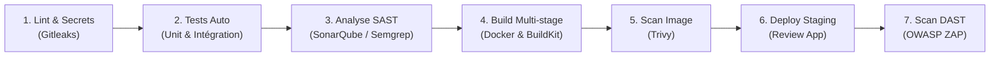

# SecurePay Solutions — Core Payment API (Baseline Legacy)

> **Projet Certifiant MSPR 4.1 :** Industrialisation et Sécurisation d'une Pipeline CI/CD  
> **Établissement :** Sup de Vinci — Mastère DevOps (M1)  
> **Titre RNCP :** RNCP 40165 - Bloc 5 : *Piloter l'alignement stratégique entre architectures et DevSecOps*  
> **Pondération :** 50% de la note finale du module (avec soutenance orale et live-demo)

---

## 1. Contexte Métier & Scénario d'Entreprise

Vous venez d'être recrutés en tant qu'**Ingénieurs Platform & DevSecOps** au sein de **SecurePay Solutions**, une FinTech en forte croissance fournissant des API de paiement pour le e-commerce.

L'entreprise est en cours de mise en conformité avec sa Politique de Sécurité des Systèmes d'Information (PSSI) et les exigences strictes de production.

Actuellement, l'équipe de développement déploie manuellement l'application sur des serveurs Linux via SSH. Un audit externe de cybersécurité a rendu un rapport alarmant sur ce dépôt :

| Anomalie Détectée | Description Technique & Impact PSSI |
| :--- | :--- |
| **1. Fuite de Secrets** | Une clé API de passerelle de paiement (`STRIPE_SECRET_KEY`) est codée en dur dans le code source et présente dans l'historique Git. |
| **2. Faille SAST Majeure** | Une route de calcul (`/api/payments/calculate-tax`) utilise `eval()` directement sur une entrée utilisateur (CWE-95 : *Code Injection*). |
| **3. Vulnérabilités Conteneur** | Le `Dockerfile` actuel utilise une image complète Debian (`node:20`), tourne sous utilisateur `root` et produit une image de plus de 1.1 Go avec des centaines de CVE. |
| **4. Vulnérabilités Dépendances (SCA)** | Le fichier `package.json` embarque des bibliothèques obsolètes contenant des failles publiques critiques (ex: `jsonwebtoken`, `axios`). |
| **5. Risques DAST & En-têtes HTTP** | L'API ne définit aucun en-tête de protection (`CSP`, `HSTS`, `X-Frame-Options`) et divulgue publiquement sa bannière de serveur (`X-Powered-By: Express`). |

---

## 2. Votre Mission d'Ingénierie DevSecOps

Votre mission consiste à **concevoir, automatiser et documenter une usine logicielle CI/CD inviolable** sous **GitLab CI** (ou GitHub Actions) capable de bloquer automatiquement toute tentative de déploiement non conforme.

### Architecture de la Pipeline Attendue



### Spécifications & Barrières à Mettre en Place

1. **Shift Left & Secrets (B5C1) :**
   - Intégrer un job `secrets:gitleaks` qui analyse l'ensemble du dépôt et les commits.
   - Le pipeline doit échouer immédiatement (`exit 1`) si un secret est détecté.
   - Les vraies variables sensibles doivent être injectées via l'interface CI sous forme de variables **Masked** et **Protected**.

2. **Automatisation des Tests & Feedback Loop :**
   - Exécuter la suite de tests automatisés (`npm test`).
   - Générer et exporter le rapport de tests JUnit XML (`reports/junit.xml`) via `artifacts:reports:junit` pour un affichage natif dans les Merge Requests.
   - Générer le rapport de couverture de code (`coverage/lcov.info`).

3. **Analyse Statique de Sécurité (SAST & Clean Code) :**
   - Intégrer **SonarQube** (ou SonarCloud / Semgrep) en utilisant le fichier `sonar-project.properties`.
   - Configurer une **Quality Gate bloquante** : échec du pipeline si de nouvelles vulnérabilités (`CRITICAL` ou `HIGH`) sont introduites.

4. **Conteneurisation Optimisée & Sécurisée (Supply Chain Security) :**
   - Refactorer le `Dockerfile` legacy en version **multi-stage** :
     - Séparation stricte de l'étape de build et du runtime.
     - Image finale basée sur **Alpine** ou **Distroless**.
     - Exécution sous utilisateur non-root (`USER 1001`).
     - Taille finale attendue : **< 80 Mo** (contre 1.1 Go actuellement).
   - Exploiter le cache BuildKit (`--cache-from`).
   - Générer un inventaire des composants logiciels (**SBOM**) au format CycloneDX ou SPDX.

5. **Scan des Vulnérabilités de l'Image Conteneur (B5C1) :**
   - Intégrer **Trivy** pour auditer l'image Docker finale construite (`trivy image`).
   - Détection des vulnérabilités de l'OS de base et des dépendances embarquées.
   - Seuil de rupture bloquant : arrêt de la pipeline en cas de vulnérabilité `CRITICAL`.

6. **Déploiement Staging & Pentest Dynamique DAST (B5C2) :**
   - Déployer automatiquement l'API dans un environnement de test éphémère (ou service CI).
   - Lancer un scan dynamique OWASP ZAP headless (`ghcr.io/zaproxy/zaproxy:stable` avec `zap-baseline.py`).
   - Exporter le rapport HTML en artefact de pipeline.
   - Bloquer la livraison en cas de faille exploitable.

---

## 3. Structure du Projet

```text
securepay-api/
├── .env.example              # Template des variables d'environnement
├── .gitignore                # Exclusions Git
├── Dockerfile                # Dockerfile legacy (à refactorer)
├── sonar-project.properties  # Configuration SonarQube
├── package.json              # Dépendances applicatives & scripts de tests
├── src/
│   ├── app.js                # Déclaration Express & routes
│   ├── server.js             # Point d'entrée HTTP
│   ├── routes/
│   │   ├── auth.js           # Route /api/auth/login (JWT)
│   │   └── payments.js       # Route /api/payments (traitement & simulation)
│   └── services/
│       └── paymentService.js # Règles métier & calculs de commissions
└── tests/
    ├── unit/
    │   └── payment.test.js   # Tests unitaires des calculs
    └── integration/
        └── api.test.js       # Tests d'intégration HTTP (Supertest)
```

---

## 4. Démarrage Rapide en Local

### Prérequis
- Node.js >= 20.0.0
- npm >= 10.0.0
- Docker Desktop / Docker Engine avec BuildKit activé

### Installation des Dépendances
```bash
npm install
```

### Lancement des Tests
```bash
# Exécution simple avec génération des rapports JUnit & Coverage
npm test

# Mode surveillance pendant le développement
npm run test:watch
```

### Lancement de l'API
```bash
# Démarrage en mode développement (auto-reload)
npm run dev

# Démarrage en production
npm start
```
L'API est accessible sur `http://localhost:3000`.  
Vérifier l'état de santé :
```bash
curl http://localhost:3000/health
```

